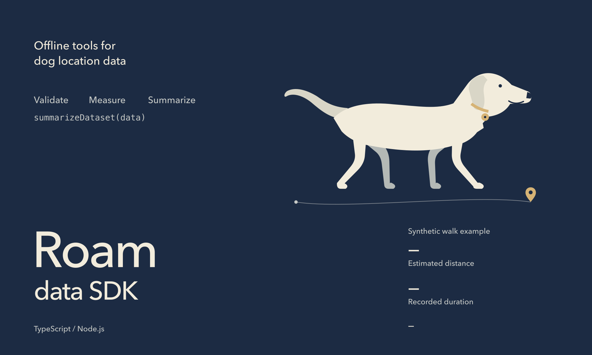

# Roam data SDK for TypeScript

<picture>
  <source media="(prefers-reduced-motion: reduce)" srcset="docs/assets/sdk-overview.png">
  
</picture>

Work with pet location datasets locally. Roam data SDK validates JSON, calculates distances, and summarizes explicitly separated history segments. It includes TypeScript definitions and has no runtime dependencies.

This is an **offline data library**. It does not connect to tracker services, sign in to accounts, or retrieve live reports. You supply data in the documented format.

The animation illustrates a workflow. You use the SDK through JavaScript or TypeScript functions; it has no graphical interface. [View the still image](docs/assets/sdk-overview.png) or [read the animation notes](docs/assets/ANIMATION.md).

## Use cases

| What you want to build | How the SDK helps | What your application supplies |
| --- | --- | --- |
| A report for saved outings | Calculate approximate distance, recorded duration, and point counts without joining separate segments | Recorded points grouped into segments |
| An import or archive workflow | Validate incoming JSON and serialize a consistent dataset for later use | Data converted to the SDK format, plus file reading and writing |
| A location-history dashboard | Provide validated points and summary values for your own interface | The interface, charts, and any map renderer |
| A prototype that works offline | Develop and test with synthetic locations and predictable results | Sample datasets and the feature you are building |

For example, two supplied 10-minute segments separated by a 50-minute gap produce 20 minutes of recorded duration. The SDK excludes the gap from both distance and duration. It uses the segments you provide rather than detecting outings automatically.

See the [use-case guide](docs/USE_CASES.md) for concrete workflows and the [history report example](examples/history-report.mjs) for runnable code.

## Documentation

- [Use cases and workflows](docs/USE_CASES.md)
- [API reference and data format](docs/API.md)
- [Synthetic example](examples/demo.mjs)

## Installation

Requires Node.js 20 or later and npm. From this repository:

```sh
npm ci
npm run build
```

To use the built SDK in another Node.js project, install it from your checkout:

```sh
npm install /absolute/path/to/roam-data-sdk
```

This release is distributed as GitHub source. No npm registry publication is part of this release.

## Getting started

Use an ES module (`.mjs`) or a TypeScript project configured for ESM:

```js
import { validateDataset, summarizeDataset } from 'roam-data-sdk';

const dataset = validateDataset({
  schemaVersion: 1,
  petId: 'sample-pet',
  batteryPercent: 87,
  segments: [[
    { latitude: 0, longitude: 0, timestamp: 0 },
    { latitude: 0, longitude: 0.01, timestamp: 600_000 },
  ]],
});

const summary = summarizeDataset(dataset);
console.log(summary.distanceKm); // Approximately 1.112 km
console.log(summary.durationMs); // 600000
```

The coordinates and timestamps above are synthetic. Run the included example with:

```sh
npm run demo
```

To read JSON that your application already has:

```js
import { parseDataset, serializeDataset } from 'roam-data-sdk';

const dataset = parseDataset(jsonText);
const json = serializeDataset(dataset);
```

Your application handles reading and writing files. The SDK operates on the supplied values and returns results.

## Data conventions

Coordinates are decimal degrees. Timestamps are nonnegative integer Unix milliseconds. Points must be in chronological order within each segment. Unknown fields and invalid values raise `TypeError` without echoing input values.

Distance is a spherical estimate between adjacent points in each segment. Duration is the sum of segment spans, excluding gaps between segments. Overlapping segments are counted separately. The SDK does not infer walks, remove GPS noise, or improve measurement accuracy.

## Development

```sh
npm run check
```

This checks types, builds the SDK, runs synthetic tests, and scans source-release files. Tests cover validation, JSON round trips, timestamp boundaries, coordinate ranges, antimeridian distances, and segment gaps. The release scan checks common secret patterns and excluded files; it cannot detect every possible sensitive value.

See [CONTRIBUTING.md](CONTRIBUTING.md) for development guidance and [SECURITY.md](SECURITY.md) for reporting vulnerabilities.

## License

Original code is available under the [MIT license](LICENSE). See [third-party notices](THIRD_PARTY_NOTICES.md) for development tooling.
